<div align="center">


### اسمع وشوف على موجتك · Ride your own wave

[](License)
[](#)
[](#)
[](admin-web)
[](https://github.com/RX3C9/Mawja/actions)

**[English](#-mawja) · [العربية](#-موجة)**

</div>

---

## 📱 Screenshots · لقطات

Captured automatically by CI on a real Android emulator from commit `df3b1fd`.

**English**

<table>
<tr><td align="center">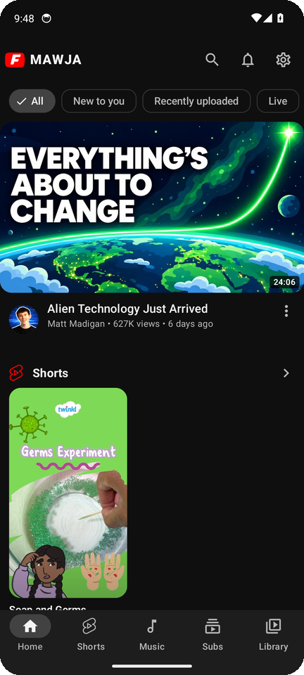<br/><sub>Home</sub></td><td align="center">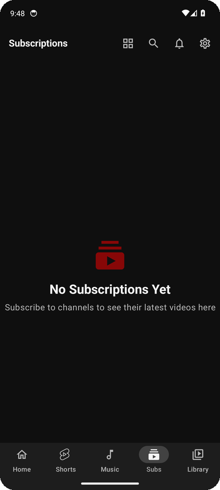<br/><sub>Subscriptions</sub></td><td align="center">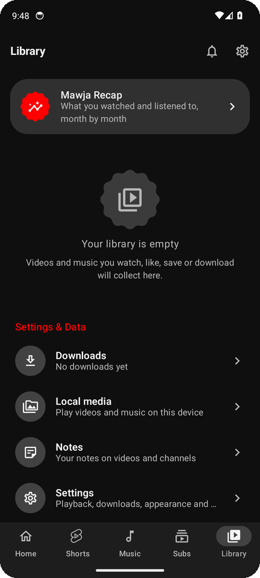<br/><sub>Library</sub></td><td align="center">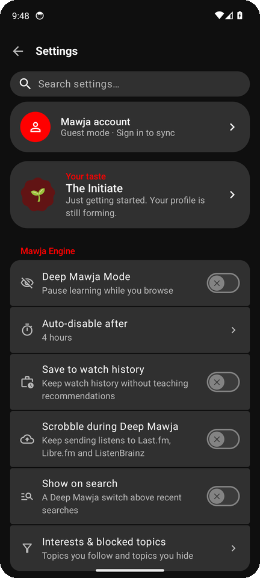<br/><sub>Settings</sub></td></tr>
<tr><td align="center">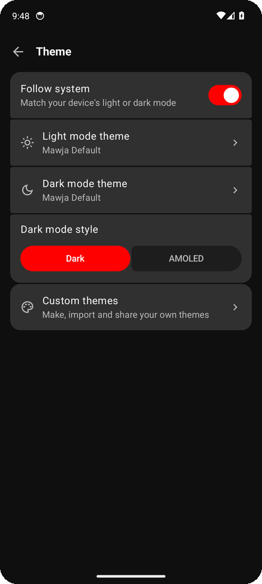<br/><sub>Themes</sub></td><td align="center">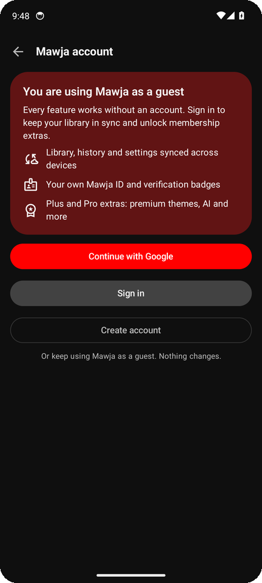<br/><sub>Mawja account</sub></td><td align="center">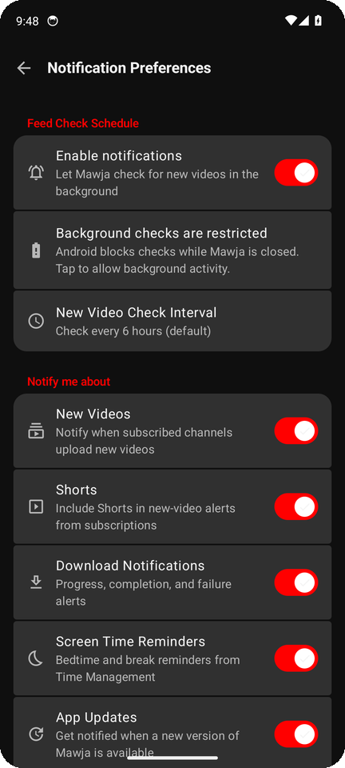<br/><sub>Notifications</sub></td><td align="center">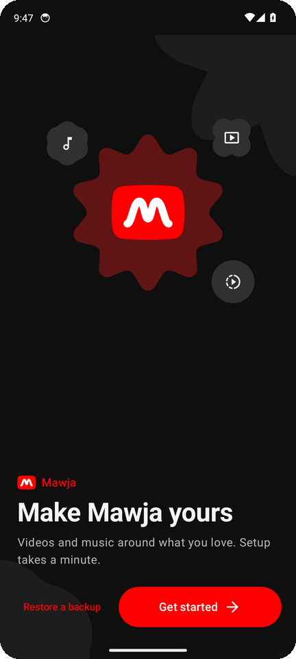<br/><sub>First launch</sub></td></tr>
</table>

**العربية**

<table dir="rtl">
<tr><td align="center"><br/><sub>الرئيسية</sub></td><td align="center">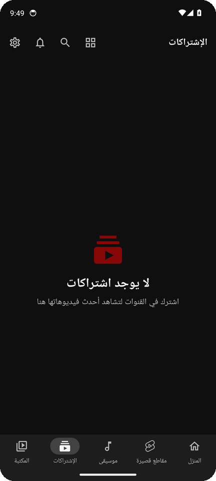<br/><sub>الاشتراكات</sub></td><td align="center">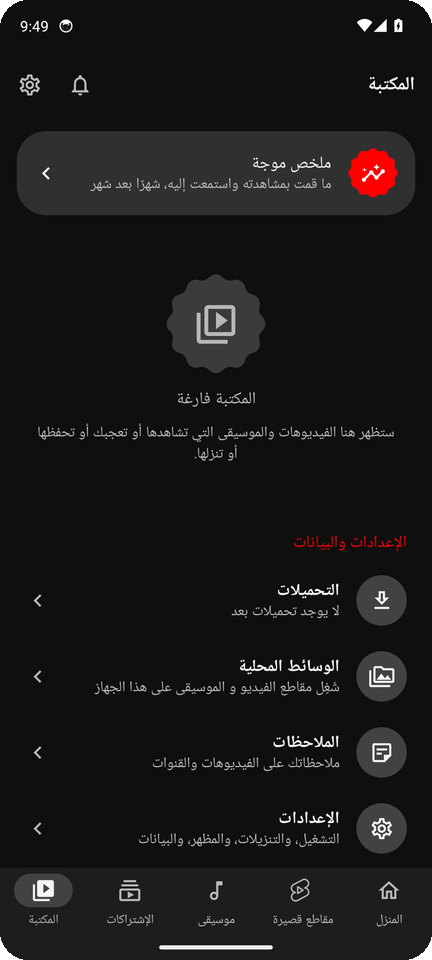<br/><sub>المكتبة</sub></td><td align="center">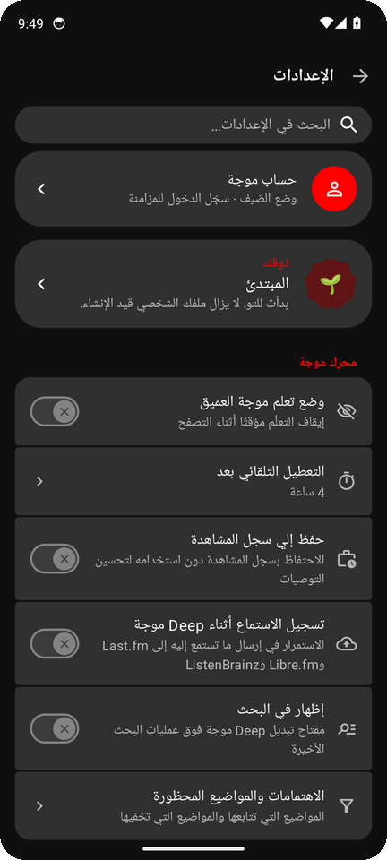<br/><sub>الإعدادات</sub></td></tr>
<tr><td align="center">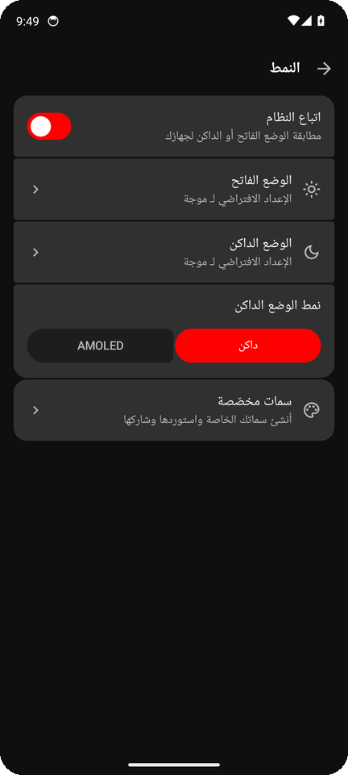<br/><sub>الثيمات</sub></td><td align="center">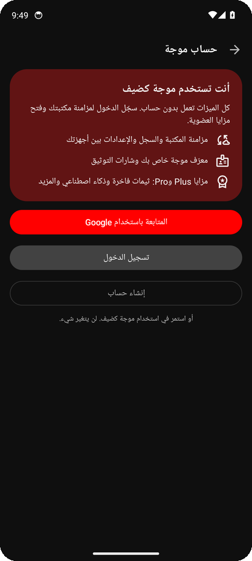<br/><sub>حساب موجة</sub></td><td align="center">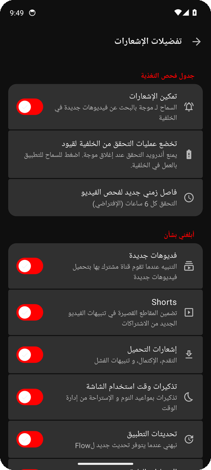<br/><sub>الإشعارات</sub></td></tr>
</table>

## 🌊 Mawja

Mawja is a premium, privacy-first YouTube and YouTube Music client for Android. It keeps **every feature of [Flow](https://github.com/Flow-Tube/Flow)** and its exact original design, then builds a whole ecosystem on top:

| | |
|---|---|
| 🎬 **Mawja** | The main app: video, music, Shorts, lyrics, on-device recommendations (FlowNeuro) |
| ⬇️ **Mawja Downloader** | A dedicated companion app that does every download, linked to Mawja by a signature-protected AIDL service |
| 🛡️ **Mawja Admin** | Android app **and** [web dashboard](admin-web) for the team: users, memberships, badges, feature switches, announcements, reports, audit log |
| ☁️ **Backend** | Firebase Auth + Firestore rules + Cloud Functions (Mawja ID, usernames, role-checked admin actions) |
| 🔔 **Smart notifications** | Learned **on your device**: your usual hours, what you open, quiet hours, a daily cap, never the same nudge twice |
| 🪪 **Mawja ID & badges** | A unique `MW-XXXX-XXXX` for every account (typo-checked) and verified badges |
| 💎 **Plus & Pro** | Premium themes (like **Nile**), effects, sounds, cloud sync and AI, while everything from Flow stays free |

### ✨ What's new

- **Memberships, done right**: an entitlement model (Free / Plus / Pro / Lifetime / Family → features). Premium palettes show a *Plus* badge and an upsell; Flow Default and every original palette stay free. A downgrade falls back to Flow Default and your choice comes back when you re-upgrade.
- **Adaptive notifications**: *continue watching*, *new from a channel you love*, a Friday *weekly recap* and *Smart DJ* at your usual listening hour. All decided on the phone; open, swipe-away and ignore teach it what you like. Quiet hours 23:00–08:00 and a daily limit you choose.
- **Admin web**: Next.js static dashboard (Arabic-first, RTL) next to the Android admin app.
- **Checkout (sandbox)**: Plus / Pro / Family / Lifetime plans through Paymob or Stripe; the server verifies the payment and grants the membership.
- **Smart network, storage guard, job centre**: metered or slow Wi-Fi is treated like mobile data, caches are cleared automatically when the phone runs low (downloads are never touched), and every background job shows its live status with *Run now* and *Stop*.

### 🧱 Build

```bash
./gradlew :app:assembleGithubDebug     # with Firebase accounts
./gradlew :app:assembleFossDebug       # no Google services, guest mode
./gradlew :downloader:assembleDebug :admin:assembleDebug
cd admin-web && npm ci && npm run build   # admin dashboard -> admin-web/out
```

CI (`scripts/ci/build.sh`) builds every APK, runs Mawja's JVM unit tests and the backend tests, and captures the screenshots above on an emulator.

<div dir="rtl">

## 🌊 موجة

موجة تطبيق يوتيوب ويوتيوب ميوزك لأندرويد، فاخر ومفتوح المصدر وبيحترم خصوصيتك. بيحتفظ **بكل ميزات Flow** وبتصميمه الأصلي بالظبط، وبيضيف فوقه منظومة كاملة:

- ⬇️ **Mawja Downloader**: تطبيق تنزيل مخصص مربوط بموجة بشكل آمن.
- 🛡️ **Mawja Admin**: تطبيق أندرويد و[لوحة ويب](admin-web) للفريق: المستخدمين، العضويات، الشارات، مفاتيح الميزات، الإعلانات، البلاغات، وسجل العمليات.
- 🔔 **إشعارات ذكية** بتتعلم على جهازك: أوقاتك المعتادة، اللي بتفتحه، ساعات هدوء، حد يومي، ومن غير تكرار.
- 🪪 **Mawja ID** فريد لكل حساب (`MW-XXXX-XXXX`) وشارات توثيق.
- 💎 **Plus وPro**: ثيمات فاخرة زي **النيل**، مؤثرات وأصوات ومزامنة وذكاء اصطناعي، وكل ميزات Flow الأصلية فاضلة مجانية.
- 💳 **الاشتراك** (تجريبي حاليًا): باقات Plus وPro والعائلة ومدى الحياة عن طريق Paymob أو Stripe، والسيرفر هو اللي بيتأكد من الدفع ويفعّل العضوية.
- 📶 **شبكة ذكية وحماية للمساحة ومركز للمهام**: الواي فاي البطيء أو المحدود بيتعامل زي باقة الموبايل، الكاش بيتمسح لوحده لما المساحة تقل (من غير ما يلمس التنزيلات)، وكل مهمة في الخلفية بحالتها مع «شغّل دلوقتي» و«إيقاف».

> موجة مبنية على **[Flow](https://github.com/Flow-Tube/Flow)** من تطوير **[A-EDev](https://github.com/A-EDev)**، ومرخّصة GPL-3.0 زيه بالظبط. مش تابعة ليوتيوب أو جوجل.

</div>

## 🗺️ Roadmap

- [x] Rebrand foundation (name, app id `app.mawja.android`, CI)
- [x] Accounts: guest mode, email/username + Google, Mawja ID, badges
- [x] Mawja Downloader companion app (AIDL, signature permission)
- [x] Mawja Admin Android app + backend (rules, functions, audit log)
- [x] Membership entitlements + premium themes (Nile)
- [x] On-device adaptive notifications
- [x] Admin web dashboard (Next.js)
- [x] Memberships checkout (Paymob + Stripe, sandbox) with server-granted entitlements
- [x] Smart network manager, storage guard and background job centre
- [ ] Live payments
- [ ] Mawja Brain AI
- [ ] 200 features across 13 areas

## ❤️ Credits

Mawja stands on the shoulders of **[Flow](https://github.com/Flow-Tube/Flow)** by **[A-EDev](https://github.com/A-EDev)**, plus [NewPipeExtractor](https://github.com/TeamNewPipe/NewPipeExtractor), Media3 and the whole open-source community. See [NOTICE.md](NOTICE.md).

## 📜 License

GPL-3.0, like Flow. Mawja is not affiliated with YouTube or Google.
