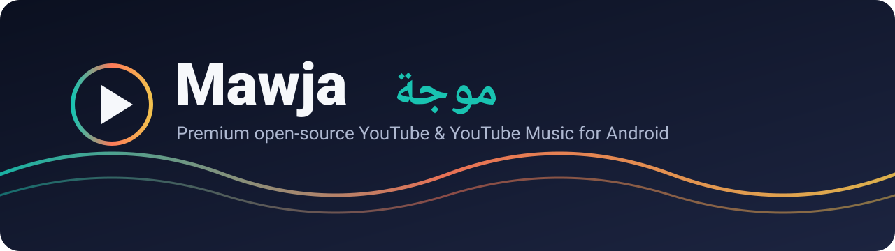

### اسمع وشوف على موجتك · Ride your own wave

**[العربية](#-موجة) · [English](#-mawja)**

---

## 🌊 Mawja

Mawja is a premium, privacy-first YouTube and YouTube Music client for Android. It keeps **every feature of [Flow](https://github.com/Flow-Tube/Flow)** and its exact original design, then builds a whole ecosystem on top:

| | |
|---|---|
| 🎬 **Mawja** | The main app: video, music, Shorts, lyrics, on-device recommendations |
| ⬇️ **Mawja Downloader** | A dedicated companion app that handles every download, securely linked to Mawja |
| 🛡️ **Mawja Admin** | A separate control app for the team: users, memberships, verification, feature switches |
| 🧠 **Mawja Brain** | Deep AI built in: summaries, questions about any video, smart DJ, playlist generation |
| 🔔 **Smart notifications** | Learned on your device, different for every person, never repeated, never spammy |
| 🪪 **Mawja ID & verification** | A unique ID for every account and verified badges |
| 💎 **Plus & Pro** | Premium themes, effects, sounds, cloud sync and AI, while everything from Flow stays free |

> Screenshots are generated automatically from the real app on CI and will appear here with each milestone.

## 🌊 موجة

موجة تطبيق يوتيوب ويوتيوب ميوزك لأندرويد، فاخر ومفتوح المصدر وبيحترم خصوصيتك. بيحتفظ **بكل ميزات Flow** وبتصميمه الأصلي بالظبط، وبيضيف فوقه منظومة كاملة: تطبيق تنزيل مخصص، تطبيق أدمن منفصل، ذكاء اصطناعي جذري، إشعارات ذكية مختلفة لكل شخص، معرّف Mawja ID وتوثيق، وعضويات Plus وPro.

## 🗺️ Roadmap

- [x] Rebrand foundation (name, app id `app.mawja.android`, CI)
- [ ] Accounts: Google + username/password, Mawja ID, verification
- [ ] Mawja Downloader companion app
- [ ] Mawja Admin app + backend
- [ ] Memberships (Plus / Pro) and premium themes, sounds and effects
- [ ] Mawja Brain AI and smart notifications
- [ ] 200 features across 13 areas

## ❤️ Credits

Mawja stands on the shoulders of **[Flow](https://github.com/Flow-Tube/Flow)** by **[A-EDev](https://github.com/A-EDev)**, plus [NewPipeExtractor](https://github.com/TeamNewPipe/NewPipeExtractor), Media3 and the whole open-source community. See [NOTICE.md](NOTICE.md).

## 📜 License

GPL-3.0, like Flow. Mawja is not affiliated with YouTube or Google.
